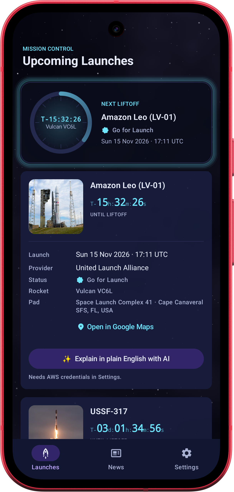
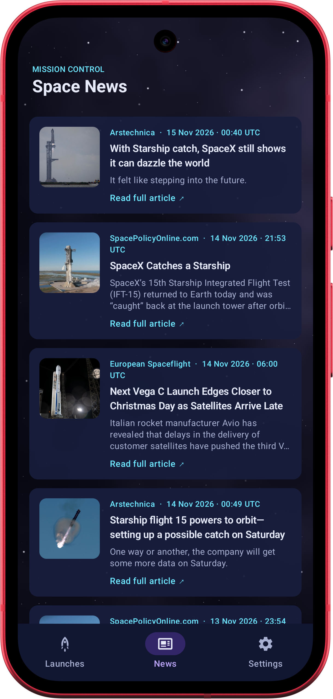
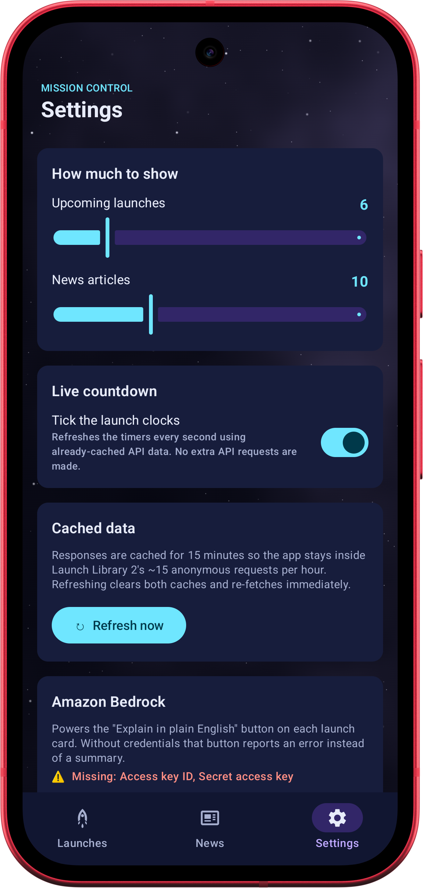

# Space Launches & News Tracker

A native Android app — Kotlin, Jetpack Compose, Material 3 — that counts down to upcoming
rocket launches and collects the latest spaceflight news, under an animated deep-space sky.

<p align="center">
  
  &nbsp;
  
  &nbsp;
  
</p>

## Features

- **Upcoming launches** — a *Next liftoff* ring that fills over the final 24 hours, and a
  card per mission with a live `T-` clock, provider, status, rocket and pad, plus a link
  that opens the pad in Google Maps.
- **Explain in plain English with AI** — rewrites a technical mission description into a
  few jargon-free sentences using Amazon Bedrock. Each summary is cached, so a mission costs
  at most one model call.
- **Space news** — recent headlines with source, date and summary; tap through to the full
  article.
- **Settings** — how many launches and articles to show, a live-countdown toggle, a cache
  refresh, and the Bedrock credentials.
- **Built to fail gracefully** — errors explain what happened, why, and what to do, with
  technical details on request and a retry; missing images fall back to generated artwork.

Many of the UI components come from **Space Composify**, a companion catalog of Jetpack
Compose techniques built on the same models and palette.

## Data sources

- **Upcoming launches** — [Launch Library 2](https://thespacedevs.com/llapi) (The Space Devs)
- **Space news** — [Spaceflight News API v4](https://spaceflightnewsapi.net)

Both are free and need no API key. Responses are cached for 15 minutes so the app stays
inside Launch Library 2's ~15 anonymous requests per hour; *Refresh now* in Settings clears
both caches and re-fetches immediately.

## Building

Requires Android 13 (API 33) or later.

```bash
./gradlew :app:installDebug
```

The *Explain* feature needs AWS credentials with access to Amazon Bedrock. Enter them in
Settings, or pre-fill them at build time in `local.properties` (never committed):

```properties
bedrock.region=us-west-2
bedrock.modelId=us.anthropic.claude-haiku-4-5-20251001-v1:0
bedrock.accessKeyId=...
bedrock.secretAccessKey=...
bedrock.sessionToken=...        # temporary credentials only
```

Without that file the build falls back to the `AWS_REGION`, `BEDROCK_MODEL_ID`,
`AWS_ACCESS_KEY_ID`, `AWS_SECRET_ACCESS_KEY` and `AWS_SESSION_TOKEN` environment variables. Because the values
are compiled into the APK, don't share an APK built with real credentials.
